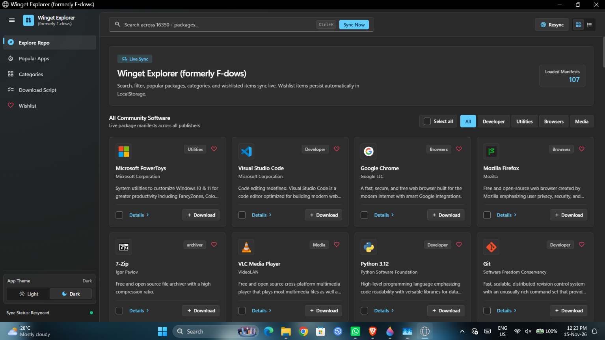

# Ambient F-dows
The Free and Open Source Windows App Store (F-dows)

## 📖 Features

* FOSS Only: Hosts exclusively free and open-source software, allowing anyone to inspect source code.
* Privacy Focused: Excludes built-in analytics, trackers, or hidden advertising frameworks.
* Anti-Feature Warnings: Flags apps explicitly if they include undesirable traits like ads or tracking.
* Custom Repositories: Allows users to add and use third-party or self-hosted software repositories easily.
* 100% Safe & Verified via VirusTotal
* Fast Speed
* Zero Ads & Zero Tracking

## ❓ How to upload apps to F-dows FOR COMPLETELY FREE

### Before Start
* Ensure your app is FLOSS (Free, Libre and Open Source)
* Ensure your app is 100% safe and virus-free
* Ensure your app is privacy-focused, no ADS and in-app-purchase
* Ensure your app source code is in the provided GitHub repo URL

### What to do
* Double check and ensure your Github repo have the COMPLETE source code
* Create a file named f-dows.txt in your GitHub repo main branch
* Ensure the f-dows.txt contains the App Name, developer name, short description (Max 80 characters), long description, App logo URL, Download link URL, screenshot 1 image URL and screenshot 2 image URL (optional).
* You can get the images URL by creating a new folder in main branch named f-dows-images and upload it.
* Once you completed, email to me (tempu3544@gmail.com), your project will verify and reviewed by our team.
* Check https://techambient.github.io/F-dows/store daily and check email app daily, you will be replied once your app either successfully uploaded to F-dows or rejected by our team. 

## 📷 Screenshots

## ☕ Support

If you like this project, kindly star this repo as basic support and give some donations to help keep it alive!

* **Solana (SOL / USDC):** `EME9M9cSy9FvfHvcx2gMPkp1H5Dj4YaKufPRsAyon8Tf`
* **Bitcoin (Taproot):** `bc1pguvpjudf9gr2lyjcf4s9ttvzushgu0hqhr2p7fwqzsz4977kajcqemvned`
* **Bitcoin (Native Segwit):** `bc1qwfjwytw8lehg20es373cx2ulr3el99rt9uurz5`

## 💬 Join My Discord Server

Join my discord server at <a href="https://discord.gg/ATnXUUnS">
  Click Here To Join my Discord server
</a>! 

## 🔨 Contributing

Pull requests are strongly recommended. For major changes, please open an issue first to discuss what you would like to change.

## 📜 License

This project is licensed under [GPL-v3](/LICENSE)
